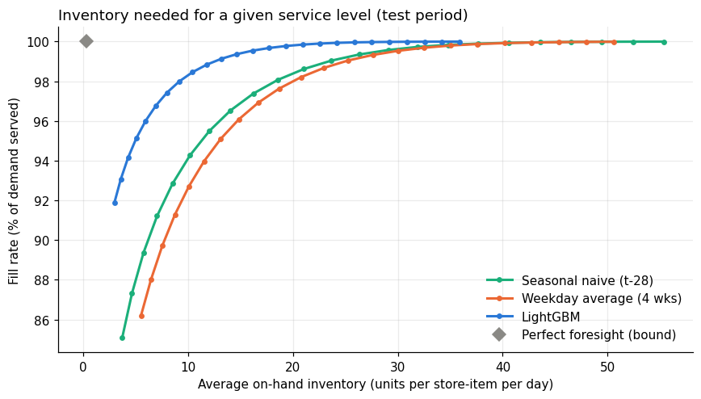
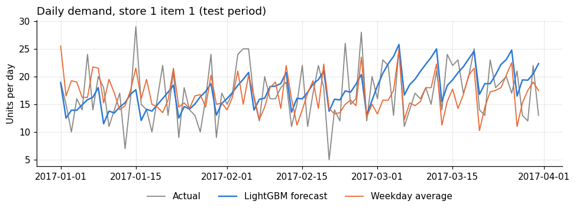

# Forecast-then-Optimize Inventory

Does a better demand forecast mean less inventory? This project forecasts daily demand for 500 store-item series with a gradient-boosted model, feeds the forecasts into an order-up-to inventory policy, and measures how much stock each forecasting method needs to deliver the same service level.

Forecasts are judged on **operational value** (inventory held versus fill rate), not only on error metrics.

**Headline result:** at a 98% fill rate, the LightGBM forecast needs about **9.2 units on hand per store-item per day, versus 18.3 for the better simple benchmark and 20.0 for the other**, roughly 50% less inventory (46% to 56% less across 95% to 99% fill).

## Highlights

- **Leakage-safe by construction.** Every feature for date *t* uses only sales from *t − 28* or earlier. Unit tests change the "future" data and check that the features do not move.
- **Three-way time split.** Hyperparameters are chosen on a validation period; safety-stock error estimates also come from validation; the test period is evaluated once.
- **Forecast to decision.** Forecasts drive a periodic-review base-stock policy simulated with lost sales. Safety factors are swept to trace each method's inventory-versus-fill-rate frontier.
- **Tested.** Pytest checks for feature leakage and for the simulator (perfect foresight, monotone service versus stock, cost accounting).

## Results

Test period: 2017-01-01 to 2017-03-31, 500 store-item series. Benchmarks use the same 28-day information limit as the model.

**Forecast accuracy (test)**

| Method | WAPE | MAE | RMSE | Bias |
|---|---|---|---|---|
| Seasonal naive (t − 28) | 18.75% | 8.59 | 11.28 | −7.2% |
| Weekday average (4 weeks) | 19.28% | 8.83 | 11.65 | −4.7% |
| LightGBM | 11.63% | 5.33 | 6.91 | +0.8% |

**Average on-hand inventory needed (units per store-item per day) for a target fill rate**

| Method | 95% fill | 98% fill | 99% fill |
|---|---|---|---|
| Seasonal naive (t − 28) | 11.29 | 18.33 | 23.41 |
| Weekday average (4 weeks) | 12.98 | 20.02 | 24.96 |
| LightGBM | 4.97 | 9.19 | 12.55 |

Against the better benchmark (seasonal naive) LightGBM needs 56%, 50%, and 46% less inventory at 95%, 98%, and 99% fill. On the lowest-cost operating point under the assumed cost ratio, simulated total cost is 37% lower than seasonal naive. All figures are in `results/summary.json`; a perfect-foresight run (an unreachable floor) needs about 0.35 units on hand.

The LightGBM test WAPE (11.6%) is close to the irreducible noise of this data. If daily sales were Poisson around a known mean, a perfect forecast would still show a WAPE of roughly 0.8 / √(mean daily sales), about 11.8% on the test period's average of about 46 units per day. The model is therefore using nearly all of the predictable structure, and the benchmark gap comes from the structure that the simple methods miss.





## Approach

**Data.** Kaggle's *Store Item Demand Forecasting Challenge*: daily unit sales for 50 items in 10 stores, 2013-01-01 to 2017-12-31 (`date, store, item, sales`). The file is not included in this repo (see [Reproducing](#reproducing-the-results)).

**Features** (`src/features.py`). Lags at 28, 35, 42, 49, 56, and 364 days; rolling mean (7, 28, 91 days) and standard deviation (28 days) and a 365-day mean, all computed on data shifted by 28 days; calendar features; store and item as categoricals.

**Model.** LightGBM with a Poisson objective, random search over six hyperparameters using the validation period with early stopping. The chosen configuration is refit on train + validation for the final forecast.

**Benchmarks.** Seasonal naive (sales 28 days earlier) and a weekday average over the previous four weeks, both limited to the same information.

**Validation design**

| Period | Dates | Used for |
|---|---|---|
| Train | start to 2016-06-30 | fitting |
| Validation | 2016-07-01 to 2016-12-31 | hyperparameters, forecast-error spread for safety stock |
| Test | 2017-01-01 to 2017-03-31 | final accuracy and inventory simulation, evaluated once |

**Inventory simulation** (`src/simulate.py`). Daily review, order-up-to policy, fixed lead time, lost sales. The order-up-to level is the forecast demand over the protection period plus `z × σ × √(protection period)`, where σ is each series' forecast-error RMSE on the validation period. Sweeping *z* gives the frontier.

Assumptions (set in the notebook's configuration cell): lead time of 2 days, daily review, holding cost of 1 and lost-sale cost of 20 per unit (relative scale). These are illustrative, not estimated from a real retailer.

## Limitations

- **The data looks very clean.** Forecast errors sit near the Poisson noise floor (see Results), which suggests demand in this dataset is a smooth pattern plus count noise, with few of the promotions, stockouts, or shocks of real retail. Gains on messier real-world data are likely to be smaller.
- **Simple benchmarks.** Both benchmarks use only the last 4 to 7 weeks of history, so they cannot follow the yearly seasonal pattern. A stronger benchmark that uses last year's same-weekday sales would narrow the gap.
- One retailer's data with mostly smooth, non-intermittent demand. Slow-moving items would need other methods (Croston-type models, quantile forecasts).
- Safety stock assumes error scales with √(protection period) and uses one validation window to estimate σ.
- Lead time is fixed and known; there are no capacity limits, minimum order sizes, or shelf life; unmet demand is lost.
- One three-month test window. A rolling-origin evaluation would show variability across seasons.

## Reproducing the results

```bash
pip install -r requirements.txt
pytest                          # leakage and simulator tests
jupyter notebook notebooks/inventory_forecast_optimization.ipynb
```

1. Download `train.csv` from the Kaggle [Store Item Demand Forecasting Challenge](https://www.kaggle.com/competitions/demand-forecasting-kernels-only/data) (free account; accept the competition terms) and save it as `data/train.csv`. Do not commit it.
2. Run the notebook top to bottom. The model search is the slow step: the default 6 trials took about 1.5 minutes in Google Colab and will take longer on a 2-core laptop. Set `N_SEARCH` to change it.
3. Results are written to `results/` (`summary.json`, `frontier.csv`, figures).

**Google Colab.** Open the notebook in Colab and run it. If the repository is public, the first cell clones it automatically (edit `REPO_URL` there if your repo has a different name). Then upload `train.csv` to the cloned `inventory-forecast-optimization/data/` folder using Colab's file browser. Don't open the notebook alone and "fix" the missing `src/` import by pasting simplified code into it; the results depend on the exact logic in `src/`. If the notebook can't find `src/`, it stops with an error on purpose.

To smoke-test the code without the download, run with the environment variable `USE_DEMO=1`. This uses simulated data with the same schema and writes to `results/demo/`. Those outputs are not results.

## Repository layout

```
.
├── notebooks/inventory_forecast_optimization.ipynb
├── src/
│   ├── features.py     # leakage-safe features and benchmark forecasts
│   ├── simulate.py     # base-stock inventory simulation
│   ├── metrics.py      # WAPE, MAE, RMSE, bias
│   └── demo_data.py    # simulated data for smoke tests
├── tests/              # leakage and simulator tests
├── results/            # outputs from the real-data run
├── requirements.txt
└── README.md
```

## Tech stack

Python, pandas, NumPy, SciPy, LightGBM, matplotlib, pytest.
