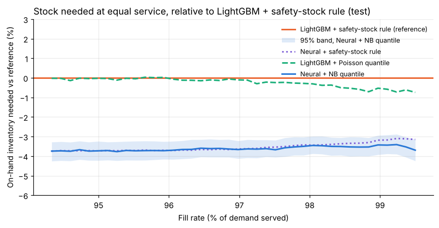
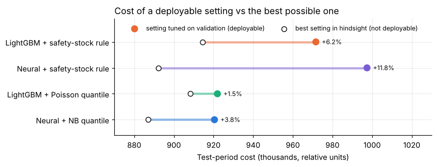
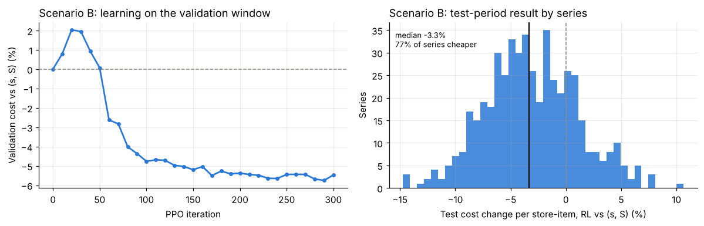
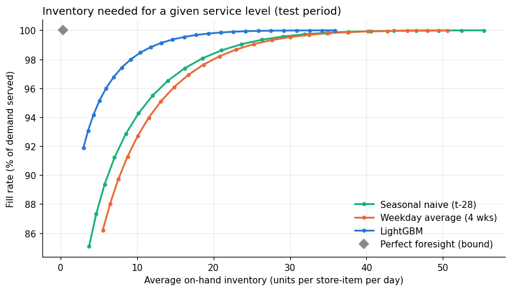
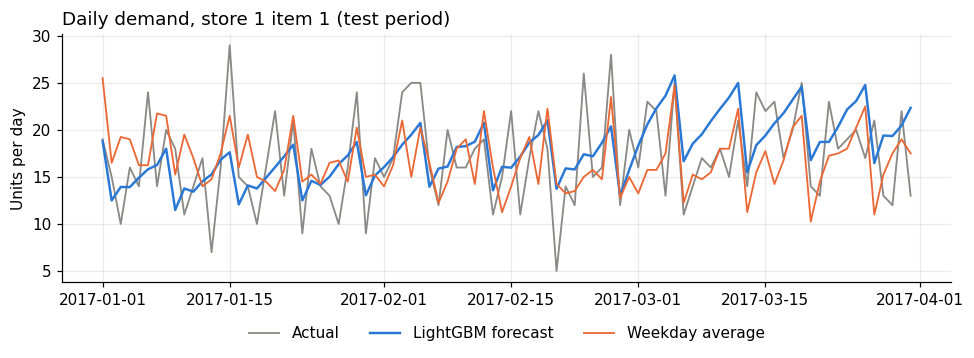

# Forecast-then-Optimize Inventory

Does a better demand forecast mean less inventory? This project forecasts daily demand for 500 store-item series with a gradient-boosted model, feeds the forecasts into an order-up-to inventory policy, and measures how much stock each forecasting method needs to deliver the same service level.

Forecasts are judged on **operational value** (inventory held versus fill rate), not only on error metrics.

A second notebook extends the project with a **probabilistic PyTorch forecaster** and a **reinforcement-learning ordering agent** (PPO); see [Extension](#extension-probabilistic-deep-learning-and-reinforcement-learning).

**Headline result:** at a 98% fill rate, the LightGBM forecast needs about **9.2 units on hand per store-item per day, versus 18.3 for the better simple benchmark and 20.0 for the other**, roughly 50% less inventory (46% to 56% less across 95% to 99% fill).

## Highlights

- **Leakage-safe by construction.** Every feature for date *t* uses only sales from *t − 28* or earlier. Unit tests change the "future" data and check that the features do not move.
- **Three-way time split.** Hyperparameters are chosen on a validation period; safety-stock error estimates also come from validation; the test period is evaluated once.
- **Forecast to decision.** Forecasts drive a periodic-review base-stock policy simulated with lost sales. Safety factors are swept to trace each method's inventory-versus-fill-rate frontier.
- **Tested.** Pytest checks for feature leakage and for the simulator (perfect foresight, monotone service versus stock, cost accounting).

## Extension: probabilistic deep learning and reinforcement learning

Notebook: `notebooks/probabilistic_forecast_and_rl.ipynb`. Same data, splits, features, and simulator. Every policy setting is tuned on the validation period; the test period (Q1 2017) is used once. Confidence intervals resample the 500 series (bootstrap).

**Headline results (test period)**

- **Distribution-aware ordering is about 5% cheaper to run.** With settings chosen on validation, ordering up to a quantile of the forecast distribution costs 5.3% less than the classic safety-stock rule (95% CI −5.7% to −4.8%; cheaper for 86% of store-items). The safety-stock rule tuned on validation overshoots: it costs 6.2% more than its own best setting in hindsight, against 1.5% to 3.8% for the quantile policies.
- **The neural forecaster needs about 3.5% less stock for the same service** (95% CI −4.0% to −3.0% at 98% fill) than LightGBM, even though its test WAPE is slightly worse (11.95% vs 11.63%). Error metrics and decision value disagree.
- **RL beats a tuned (s, S) policy by 3.5% when orders have a fixed cost** (95% CI −3.9% to −3.1%; cheaper for 77% of store-items), with a higher fill rate and less stock. It also beats the best (s, S) setting chosen in hindsight on the test period.
- **Where theory says base-stock is near-optimal, RL finds little:** −1.1% against the same base-stock rule, a check that the agent is not exploiting the simulator.

### Probabilistic PyTorch forecaster (`src/torch_forecast.py`)

One global network for all 500 series outputs a **negative-binomial distribution** per store-item-day (mean `μ`, variance `μ + αμ²`), trained on the negative-binomial likelihood. Lag and rolling features enter as ratios to the series' yearly level; store, item, weekday, and month enter as learned embeddings. Ensemble of 3 seeds, 12 epochs each, about 1.5 minutes per model on 2 CPU cores.

The yearly (365-day) level was chosen over the 91-day level on a **Q1-2016 backtest** (train to 2015, forecast Jan to Mar 2016), not on the test period:

| Q1-2016 backtest | WAPE | Bias |
|---|---|---|
| LightGBM | 12.08% | −2.7% |
| Neural, 91-day level | 11.73% | +0.6% |
| Neural, 365-day level | 11.71% | +0.4% |

**Point and probabilistic accuracy (test).** CRPS scores the whole distribution in units of demand (it equals MAE for a point forecast). Coverage is the share of outcomes inside central prediction intervals.

| Test, Q1 2017 | WAPE | Bias | CRPS | 50% interval | 80% | 90% | 95% |
|---|---|---|---|---|---|---|---|
| LightGBM + normal (safety-stock rule's implied distribution) | 11.63% | +0.8% | 3.80 | 56.2% | 85.7% | 93.8% | 97.1% |
| LightGBM + Poisson | 11.63% | +0.8% | 3.77 | 49.4% | 79.4% | 89.4% | 94.4% |
| Neural negative binomial | 11.95% | +4.0% | 3.84 | 49.6% | 79.7% | 89.8% | 94.7% |

The neural intervals are close to nominal, while the safety-stock rule's implied intervals are too wide. On point accuracy the neural model beat LightGBM on validation (10.10% vs 10.35% WAPE) and on the Q1-2016 backtest, but not on Q1 2017, where it over-forecast by 4%: the drop from Q4 2016 to Q1 2017 was larger than in prior years.

**Inventory decisions.** The quantile rule orders up to the *q*-quantile of demand over the protection period (lead time), so safety stock follows the forecast's own day-by-day uncertainty.

| Policy | On-hand @ 98% fill | vs reference | Test cost, tuned on validation | vs reference | Tuning gap vs hindsight |
|---|---|---|---|---|---|
| LightGBM + safety-stock rule (reference) | 9.19 | — | 971.6k | — | +6.2% |
| Neural + safety-stock rule | 8.87 | −3.4% | 997.4k | +2.7% | +11.8% |
| LightGBM + Poisson quantile | 9.15 | −0.3% | 922.0k | −5.1% | +1.5% |
| Neural + NB quantile | 8.87 | −3.5% | 920.5k | −5.3% | +3.8% |





### Reinforcement learning for ordering (`src/rl_env.py`, `src/rl_agent.py`)

A vectorised environment runs the same lost-sales dynamics over all 500 series (a unit test checks it reproduces the simulator exactly). A shared actor-critic network, trained with **PPO** in PyTorch (clipped objective, GAE, reward scaling, critic warm-up), observes stock, the order pipeline, and the neural forecast distribution. The agent learns a **residual** on top of a tuned heuristic: an untrained agent reproduces the heuristic exactly, so any gain is what RL adds. It trains on the validation period only.

**Scenario B, fixed cost per order (100 relative units).** Ordering daily is wasteful; the benchmark is a forecast-driven (s, S) policy (reorder below `s = m + z·sd` of protection-period demand, then order up to `s` plus a number of days of cover), both parameters grid-searched on validation.

| Scenario B, test | Cost | vs (s, S) | Fill rate | Avg on-hand | Orders per series-day |
|---|---|---|---|---|---|
| Daily base-stock, tuned on validation | 5.45M | +22.5% | 99.83% | 19.6 | 1.00 |
| (s, S), tuned on validation | 4.45M | — | 99.44% | 45.6 | 0.48 |
| (s, S), best in hindsight on test | 4.44M | −0.2% | 99.21% | 43.5 | 0.48 |
| **RL residual on (s, S)** | **4.29M** | **−3.5%** | **99.63%** | **44.1** | **0.48** |



**Scenario A, the base setting (no order cost).** RL lowers cost by 1.1% against base-stock with the validation-tuned safety factor (95% CI −1.2% to −1.1%). Both remain well above the best safety factor in hindsight, because the factor chosen on the second half of 2016 was too conservative for Q1 2017. Re-tuning matters more here than the policy class.

### Extension limitations

- One test quarter; the backtest shows point-accuracy rankings can change by year.
- Demand is close to Poisson, so the negative-binomial dispersion is small; data with promotions, stockouts, and intermittent demand would test the distributional model harder.
- Protection-period quantiles assume independent daily demands given the forecast.
- RL is trained on six months of validation data with one forecaster's outputs; gains are specific to the assumed relative costs.

## Results

Test period: 2017-01-01 to 2017-03-31, 500 store-item series. Benchmarks use the same 28-day information limit as the model.

**Forecast accuracy (test)**

| Method | WAPE | MAE | RMSE | Bias |
|---|---|---|---|---|
| Seasonal naive (t − 28) | 18.75% | 8.59 | 11.28 | −7.2% |
| Weekday average (4 weeks) | 19.28% | 8.83 | 11.65 | −4.7% |
| LightGBM | 11.63% | 5.33 | 6.91 | +0.8% |

**Average on-hand inventory needed (units per store-item per day) for a target fill rate**

| Method | 95% fill | 98% fill | 99% fill |
|---|---|---|---|
| Seasonal naive (t − 28) | 11.29 | 18.33 | 23.41 |
| Weekday average (4 weeks) | 12.98 | 20.02 | 24.96 |
| LightGBM | 4.97 | 9.19 | 12.55 |

Against the better benchmark (seasonal naive) LightGBM needs 56%, 50%, and 46% less inventory at 95%, 98%, and 99% fill. On the lowest-cost operating point under the assumed cost ratio, simulated total cost is 37% lower than seasonal naive. All figures are in `results/summary.json`; a perfect-foresight run (an unreachable floor) needs about 0.35 units on hand.

The LightGBM test WAPE (11.6%) is close to the irreducible noise of this data. If daily sales were Poisson around a known mean, a perfect forecast would still show a WAPE of roughly 0.8 / √(mean daily sales), about 11.8% on the test period's average of about 46 units per day. The model is therefore using nearly all of the predictable structure, and the benchmark gap comes from the structure that the simple methods miss.





## Approach

**Data.** Kaggle's *Store Item Demand Forecasting Challenge*: daily unit sales for 50 items in 10 stores, 2013-01-01 to 2017-12-31 (`date, store, item, sales`). The file is not included in this repo (see [Reproducing](#reproducing-the-results)).

**Features** (`src/features.py`). Lags at 28, 35, 42, 49, 56, and 364 days; rolling mean (7, 28, 91 days) and standard deviation (28 days) and a 365-day mean, all computed on data shifted by 28 days; calendar features; store and item as categoricals.

**Model.** LightGBM with a Poisson objective, random search over six hyperparameters using the validation period with early stopping. The chosen configuration is refit on train + validation for the final forecast.

**Benchmarks.** Seasonal naive (sales 28 days earlier) and a weekday average over the previous four weeks, both limited to the same information.

**Validation design**

| Period | Dates | Used for |
|---|---|---|
| Train | start to 2016-06-30 | fitting |
| Validation | 2016-07-01 to 2016-12-31 | hyperparameters, forecast-error spread for safety stock |
| Test | 2017-01-01 to 2017-03-31 | final accuracy and inventory simulation, evaluated once |

**Inventory simulation** (`src/simulate.py`). Daily review, order-up-to policy, fixed lead time, lost sales. The order-up-to level is the forecast demand over the protection period plus `z × σ × √(protection period)`, where σ is each series' forecast-error RMSE on the validation period. Sweeping *z* gives the frontier.

Assumptions (set in the notebook's configuration cell): lead time of 2 days, daily review, holding cost of 1 and lost-sale cost of 20 per unit (relative scale). These are illustrative, not estimated from a real retailer.

## Limitations

- **The data looks very clean.** Forecast errors sit near the Poisson noise floor (see Results), which suggests demand in this dataset is a smooth pattern plus count noise, with few of the promotions, stockouts, or shocks of real retail. Gains on messier real-world data are likely to be smaller.
- **Simple benchmarks.** Both benchmarks use only the last 4 to 7 weeks of history, so they cannot follow the yearly seasonal pattern. A stronger benchmark that uses last year's same-weekday sales would narrow the gap.
- One retailer's data with mostly smooth, non-intermittent demand. Slow-moving items would need other methods (Croston-type models, quantile forecasts).
- Safety stock assumes error scales with √(protection period) and uses one validation window to estimate σ.
- Lead time is fixed and known; there are no capacity limits, minimum order sizes, or shelf life; unmet demand is lost.
- One three-month test window. A rolling-origin evaluation would show variability across seasons.

## Reproducing the results

```bash
pip install -r requirements.txt
pytest                          # leakage, simulator, forecaster, scoring and RL tests (21)
jupyter notebook notebooks/inventory_forecast_optimization.ipynb
jupyter notebook notebooks/probabilistic_forecast_and_rl.ipynb   # extension, about 15 minutes on 2 CPU cores
```

1. Download `train.csv` from the Kaggle [Store Item Demand Forecasting Challenge](https://www.kaggle.com/competitions/demand-forecasting-kernels-only/data) (free account; accept the competition terms) and save it as `data/train.csv`. Do not commit it.
2. Run the notebook top to bottom. The model search is the slow step: the default 6 trials took about 1.5 minutes in Google Colab and will take longer on a 2-core laptop. Set `N_SEARCH` to change it.
3. Results are written to `results/` (`summary.json`, `frontier.csv`, figures); the extension writes to `results/extension/` (`summary.json`, figures, trained weights in `models.pt`). Set `N_SEEDS`, `EPOCHS`, `PPO_ITERS_A`, or `PPO_ITERS_B` to shorten it.

**Google Colab.** Open the notebook in Colab and run it. If the repository is public, the first cell clones it automatically (edit `REPO_URL` there if your repo has a different name). Then upload `train.csv` to the cloned `inventory-forecast-optimization/data/` folder using Colab's file browser. Don't open the notebook alone and "fix" the missing `src/` import by pasting simplified code into it; the results depend on the exact logic in `src/`. If the notebook can't find `src/`, it stops with an error on purpose.

To smoke-test the code without the download, run with the environment variable `USE_DEMO=1`. This uses simulated data with the same schema and writes to `results/demo/`. Those outputs are not results.

## Repository layout

```
.
├── notebooks/
│   ├── inventory_forecast_optimization.ipynb
│   └── probabilistic_forecast_and_rl.ipynb   # extension
├── src/
│   ├── features.py        # leakage-safe features and benchmark forecasts
│   ├── simulate.py        # inventory simulation (base-stock and any order-up-to targets)
│   ├── metrics.py         # WAPE, MAE, RMSE, bias
│   ├── demo_data.py       # simulated data for smoke tests
│   ├── data_prep.py       # shared splits
│   ├── torch_forecast.py  # PyTorch negative-binomial forecaster
│   ├── prob_metrics.py    # CRPS, coverage, PIT, protection-period quantiles
│   ├── rl_env.py          # vectorised inventory environment, (s, S) benchmark
│   └── rl_agent.py        # PPO actor-critic
├── tests/              # leakage, simulator, forecaster, scoring and RL tests
├── results/            # outputs from the real-data run
├── requirements.txt
└── README.md
```

## Tech stack

Python, pandas, NumPy, SciPy, LightGBM, PyTorch, matplotlib, pytest.
